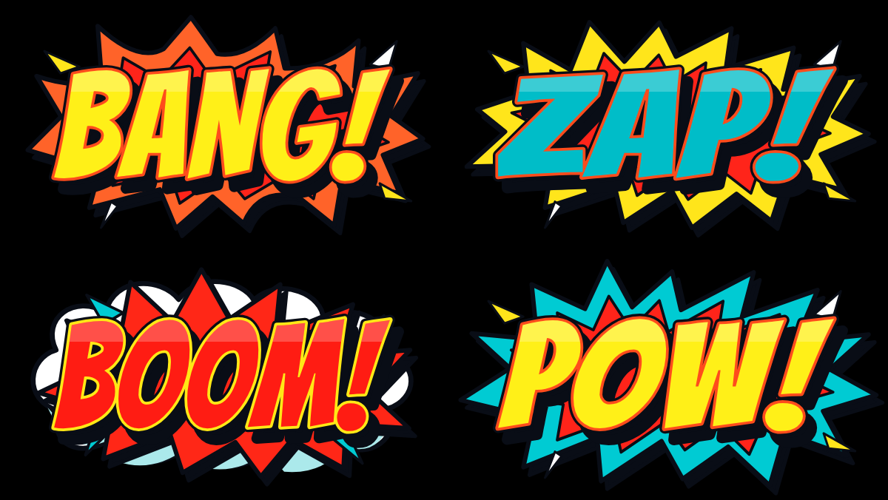
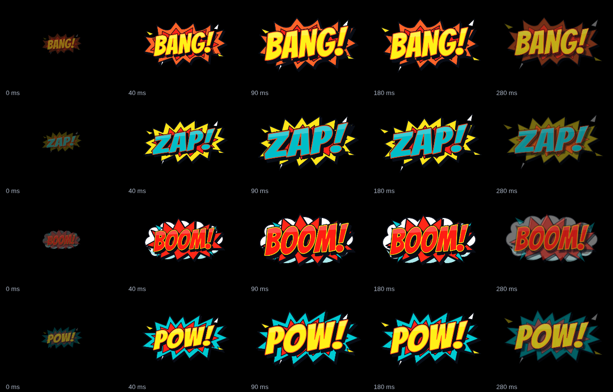

# Comic Gunfire FX — 0.15.0

An optional production effect for the existing RT / R2 input. Off by default,
including restored older projects. It uses normalized standard gamepad trigger
depth; it makes no claim to detect physical force or vendor-only gunfire signals.

## Use

Open **Effects → Right trigger · Comic Gunfire FX**, enable it and choose Random
or an individual word. Random uses a shuffled four-word bag, so each complete
bag contains all four graphics. Size and animation duration are immediately
available; Hold RT to repeat adds automatic-fire behavior.

Advanced placement & firing contains X/Y offsets, intensity, rotation variation,
threshold, repeat interval and the maximum active-burst limit. Repeat interval
is disabled when repeat is off. The active limit also applies to rapid taps.
At the limit, new emissions are skipped; existing bursts finish independently.

**Preview RT** produces a simulated press (or a 1.1-second hold when repeat is
on). It selects the manual Rest preview and releases automatically. Select
Live controller to return to physical input. Simulation never forwards into
OBS or counts toward a physical input check. Reset comic FX restores only this
feature's defaults and switches it off; Undo restores the prior settings.

## Authored assets and animation

Four transparent [SVG masters](app/comic-assets) are independently renderable at
1920 × 1080. Each uses an 800 × 450 vector composition with padded silhouettes:

- BANG!: heavy yellow italic lettering, red inner impact and orange outer burst.
- ZAP!: cyan lettering, sharp red/yellow electrical impact and a faster type snap.
- BOOM!: red lettering with a yellow keyline, explosive red geometry and a white
  scalloped cloud with a cyan cel-shaded underside.
- POW!: oversized yellow type, red impact core and cyan outer spikes with type squash.

Lettering is outlined from the SIL OFL Bangers font; there is no runtime font
lookup or dependency on installed fonts. License and source attribution are in
`app/fonts/licenses`. Original deliberate paths are shared by the runtime and
masters; they are reconstructed compositions, not crops or copied VFX stock.
`tools/build-comic-art.py` regenerates both from a supplied Bangers-Regular.ttf
with Python fontTools. The tool is for development, not required by the app.

The default timeline is 350 ms: an immediately visible 0–25 ms compression,
25–90 ms impact/overshoot, 90–200 ms layered settling and outward accent motion,
then a 200–350 ms eased exit. Lettering, burst geometry, cloud, highlights and
facets have separate transforms. ZAP has a directional type snap, POW squashes,
and BOOM's cloud continues expanding. All timing uses elapsed milliseconds.
Duration scales the full choreography without frame-count dependence.

## Placement and performance

The renderer provides the selected model's actual floating RT geometry and
controller artwork. A cached low-resolution alpha occupancy map reserves the
body, floating artwork, complete trigger travel and gauges. A summed-area map
finds the nearest clear position to the preferred above/outward RT position.
The bounds account for overshoot, rotation, jitter and exit travel. If existing
HUD widgets occupy that space, adjacent transparent space is used. Size is
reduced when necessary, and the panel reports the fitted percentage. Arbitrary
offsets never authorize painting over controls or clipping at the source edge.
Changing the controller position updates live bursts' placement; model changes
clear their transient animation state. The output stays 1672 × 1241.

Vector Path2D geometry is created once when first enabled, then reused. No
images or fonts load on a press. Each instance has its own start time and seed;
completed instances are removed. The repeat scheduler emits at most once per
frame and never queues missed shots after a stall. Disabling or Still motion
clears transient bursts immediately. Reduced motion lowers displacement,
rotation and overshoot. Trigger highlighting still uses the original renderer.

Both exported runtimes contain the same painter and vector definitions. Finished
customer overlays require no extra assets or customer configuration. Re-export
an old delivery to add the feature; renderer revision is now 6.

## Verification and limits

`comic-gunfire-test.cjs` checks threshold crossing, subthreshold input, release
hysteresis, idle and held behavior, pause recovery, independent rapid presses,
hard repeat cap, expiry, four distinct assets, shuffled selection, 30/60/144 Hz
history independence, duration, Reduced/Still motion, validation and migration.
It checks alpha/artwork preservation, safe bounds and extreme size/offsets on
legacy G7, T3 Pro Xbox, T3 Lite, N2S and T3 XS layouts. UI coverage includes
controls, preview, save/restore, reset/Undo and widths 320–1440. The exported
customer runtime is exercised with synthetic standard-gamepad input.

`tools/capture-comic-review.cjs` captures all four masters and five animation
phases on pure black. These were visually reviewed against the provided comic
reference and the existing fire/smoke and button-material review. The comparison
is an art review, not an objective certification of superior VFX quality.

Physical RT behavior and sustained 60 FPS must still be checked in Windows OBS
and Streamlabs on the target hardware, including transparent compositing and
background focus. Browser automation cannot certify those conditions. The ZIP
is a prerelease for that producer acceptance testing.
