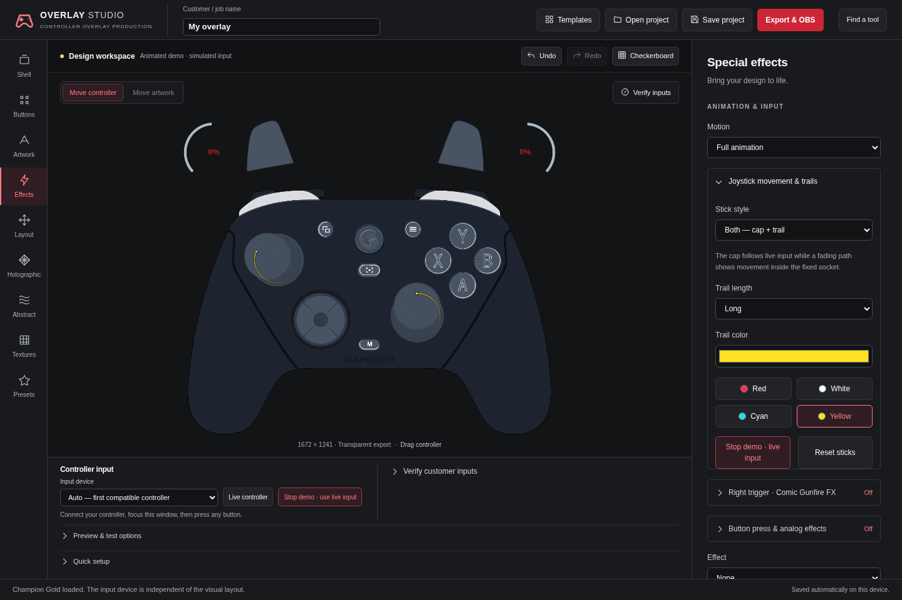
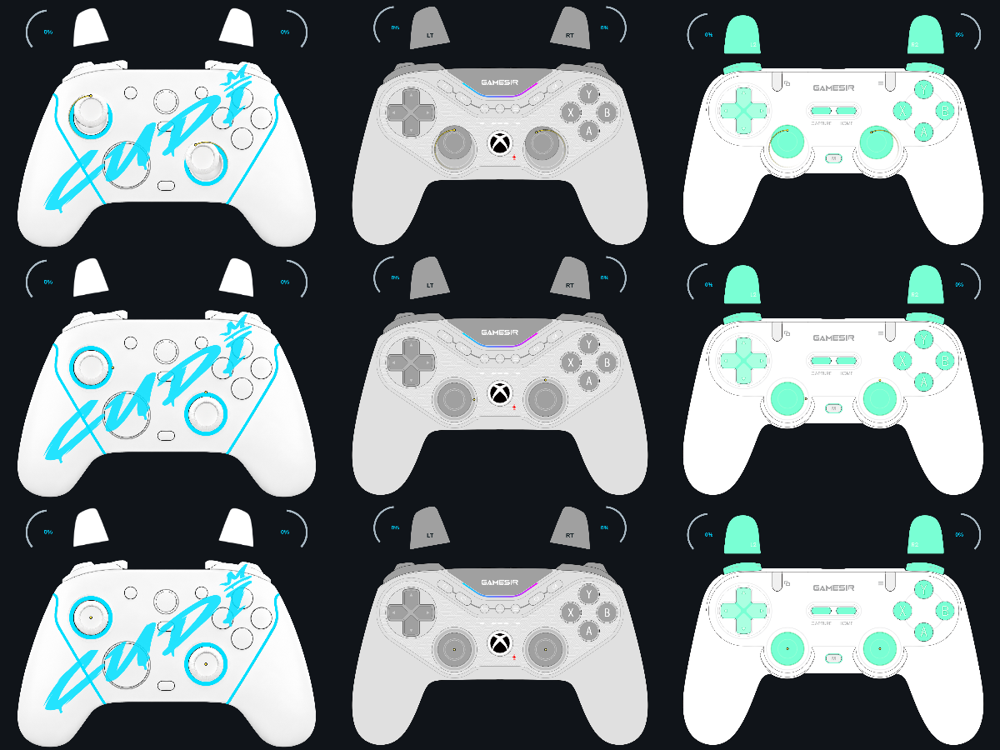

# Joystick visualization — 0.15.0

Reference reviewed: the user's **Recording 2026-11-12 002815.mp4** (31.87 seconds).
It demonstrates GameSir Overlay v0.4.2 with Tilt, Both and Trail styles, Short /
Medium / Long trails, red / white / cyan / yellow choices and a custom color picker.
The new controls reproduce those choices using Studio's existing input and
controller renderer; no original installation files are modified.

## Controls

**Effects → Joystick movement & trails**, or Find a tool → joystick:

- **Tilt — cap movement**: the current Studio behavior. The isolated cap moves
  above the stationary socket/rim. This remains the default for existing jobs.
- **Both — cap + trail**: the same cap movement plus a fading input trace.
- **Trail — position marker**: the cap stays centered; a marker shows the exact
  current normalized stick position and a fading path shows recent movement.
  Stick clicks still use the existing cap highlight and L3/R3 label.
- **Trail length**: Short 160 ms, Medium 340 ms or Long 650 ms.
- **Trail color**: four quick presets and any custom color via the native picker.
- **Try input demo**: previews both sticks without hardware. The button changes
  to Stop demo and returns to live input. Simulation is not forwarded into OBS.
- **Reset sticks**: restores Tilt and the default trail settings without
  resetting other artwork or effects. Undo restores the previous selection.

Both sticks share presentation settings. Their histories and markers are
independent. The choices persist in projects, autosave and both HTML exports.
Customers receive the finished appearance without an additional settings panel.

## Geometry and lifecycle

The selected controller's actual stick centers, cap sizes and rim sizes drive
both paths. Trail coordinates use normalized analog deflection within each
fixed socket. The cap keeps its established travel distance; the trace plots
full normalized travel across the socket for legibility. No dead zone, input
filter or smoothing delay is added to actual axes or stick clicks.

Midpoint curves smooth the recorded path geometrically while the marker stays
at the current input. The curves remain within the convex socket. A circular
clip sits inside the rim; outlines, socket art, shell and other controls remain
unchanged. A dark under-stroke keeps light trace colors legible on white skins.
Under-strokes are drawn before color to prevent dark seams at segment joins.

Each stick keeps at most 256 samples. Paths fade by elapsed milliseconds rather
than frame count, expire after release/neutral and clear on model/style changes,
clock rewinds or gaps over 250 ms. A preceding point is retained until the
adjoining segment has faded to avoid a snapped tail. Idle holds do not emit
endless new path points. Still motion hides history while preserving the live
position marker; Reduced shortens trail lifetime. Normal Tilt adds no trace.

## Verification and remaining acceptance

`stick-visualization-test.cjs` covers both histories, radial bounds, tail expiry,
Short/Medium/Long timing, return to neutral, clock/model/stall recovery, bounded
memory, Still behavior, defaults/validation, color controls, demo state,
save/restore, reset/Undo, responsive layout and the self-contained customer
runtime with synthetic standard-gamepad inputs. Legacy G7, symmetric T3 Pro
Xbox and T3 XS layouts are compared for visible traces, preserved alpha and
stationary neutral caps. Existing input-visualization tests continue checking
full stick travel, clicks, simultaneous inputs and fixed rims in default mode.

Producer acceptance still requires a physical controller in Windows and the
target OBS/Streamlabs browser source. The recorded options are implemented;
exact original GameSir trail timings or tilt perspective are not claimed.
